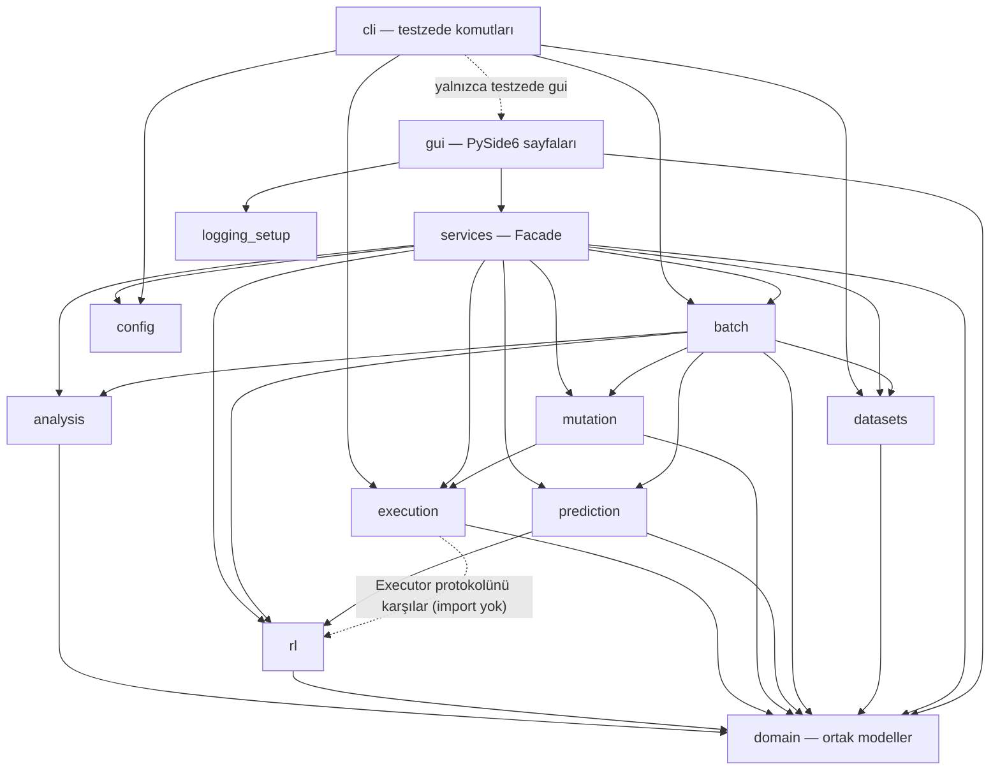

# Mimari

## 1. Genel bakış

Uygulama **N katmanlı** mimaridedir. GUI hiçbir çekirdek modülü doğrudan çağırmaz,
`services` cephesini kullanır; çekirdek türlerini yalnızca tip ipucu olarak
(`if TYPE_CHECKING:`) import eder. Komut satırı (`cli`) ise `services`'i kullanmaz,
çekirdek paketleri doğrudan çağırır. Oklar koddaki `import` bağımlılıklarıdır.



- `rl` yalnızca `domain`'e bağımlıdır; çalıştırma `rl/executor.py`'deki `Executor`
  protokolü üzerinden yapılır, gerçek uygulama (`execution.SandboxExecutor`) dışarıdan
  verilir.
- `prediction`, `rl`'in eğri ve epizot türlerini (`rl.env.CurvePoint`,
  `rl.trainer.EpisodeResult`) import eder.

## 2. Domain sözleşmesi

Ekip paralel çalışabilsin diye modüller arası veri **yalnızca** bu modellerle
taşınır (`src/testzede/domain/models.py`). Bu dosyadaki bir alan değişikliği
herkesi etkiler, PR'da üç kişinin de onayı gerekir.

```python
@dataclass(frozen=True)
class CodeUnit:
    uid: str  # "HumanEval/12", "small67/5", "<repo>::<modül>.<fonk>"
    source: str
    entry_point: str | None = None  # test edilecek fonksiyon adı
    dataset: str | None = None
    seed_examples: tuple[str, ...] = ()  # docstring'deki >>> örnekleri


@dataclass
class TestCase:
    name: str
    code: str  # tek bir pytest fonksiyonu
    origin: Literal["user", "rl"]


@dataclass
class CoverageReport:
    covered_lines: int
    total_lines: int
    covered_branches: int
    total_branches: int
    per_function: dict[str, float] = field(default_factory=dict)  # fonksiyon → kapsama oranı (0–1)

    @property
    def line_rate(self) -> float: ...


@dataclass
class MetricSet:
    values: dict[str, float]  # anahtarlar metrics.METRIC_NAMES


@dataclass
class MutationReport:
    total: int
    killed: int
    survived: int
    timeout: int

    @property
    def score(self) -> float: ...  # (killed + timeout) / total


@dataclass
class RunStats:
    generated: int
    compiled: int
    execution_time_s: float

    @property
    def compilation_rate(self) -> float: ...  # compiled / generated


@dataclass
class Prediction:
    estimated_bugs: float
    optimum_test_count: int
    method: str
```

## 3. Modüller

### analysis (US-1, US-2)
- `callgraph.py`: `ast` ile fonksiyon tanımlarını ve çağrıları çıkarır, `networkx.DiGraph`
  döndürür. Builtin çağrılar `<builtin>.len` biçiminde etiketlenir. Çizim GUI'de
  matplotlib canvas ile yapılır.
- `metrics.py`: radon `raw`, `metrics.h_visit`, `complexity.cc_visit`, `metrics.mi_visit`
  ile 14 metrik üretir: LOC, LLOC, SLOC, Yorum, Çoklu satır, Boş, Halstead
  Zorluk/Çaba/Uzunluk/Zaman/Kelime Haznesi/Hacim, Çevrimsel Karmaşıklık,
  Sürdürülebilirlik İndeksi. `METRIC_DESCRIPTIONS` her metriğin kısa açıklamasını,
  `maintainability_rank` indeksin A/B/C derecesini verir (radon eşikleri).
- `parsing.py`: iki modülün ortak ayrıştırıcısı. Söz dizimi hatası, null bayt, aşırı iç içe
  yapı ve bellek hataları `SourceError`'a çevrilir (satır numarası biliniyorsa mesajda
  yazar); kullanıcı kodundaki geçersiz kaçış dizisi uyarıları bastırılır. Hatalı kod hiçbir
  zaman ham `ValueError` olarak sızmaz.

### execution (US-3, US-5'in süre ve derlenebilirlik kısmı)
- `sandbox.py`: Her çalıştırma ayrı bir **alt süreçte** (`subprocess.run`, `timeout=`)
  geçici bir dizinde yapılır. `signal.alarm` kullanılmaz (Windows'ta yoktur).
  Sonsuz döngü ya da çöken test, yalnızca o testi `timeout`/`error` olarak işaretler.
  Uygulamayı asla düşürmez (Madde-1).
- `coverage_runner.py`: `coverage run --branch -m pytest` çalıştırır, JSON çıktısını
  `CoverageReport`'a çevirir.
- Compilation Rate: derlenen test sayısının üretilen test sayısına oranıdır. `ast.parse` ile
  ayrıştırılamayan test ve pytest raporunda `error` olan test (toplama hatası, çöken süreç)
  derlenmemiş sayılır; `py_compile` kullanılmaz. Zaman aşımına uğrayan test derlenmiş sayılır.

### rl (US-3, US-4)

Her **epizot** bir `CodeUnit` (test edilen fonksiyon) üzerinde geçer.

| Bileşen | Tasarım |
|---|---|
| Durum | (satır coverage dilimi, branch coverage dilimi, son eylem başarılı mı, adım dilimi): tabular Q-learning için ayrıklaştırılmış |
| Eylemler | Girdi üretim stratejileri: `BOUNDARY` (0, ±1, uç değerler), `EMPTY` ('' / [] / {}), `NEGATIVE`, `RANDOM_SMALL`, `RANDOM_LARGE`, `SPECIAL_CHARS`, `FROM_DOCSTRING` (>>> örnekleri), `MUTATE_BEST` (en iyi girdiyi bozma) |
| Ödül | `r = α·Δline + β·Δbranch + γ·yeni_çıktı_sınıfı − δ·(geçersiz/timeout) − ε` (ε: test başı maliyet; gereksiz test üretimini cezalandırır, optimum test sayısına yaklaştırır) |
| Bitiş | %100 branch coverage, maksimum adım ya da N adım boyunca coverage artışı olmaması |
| Oracle | Girdi, referans (canonical) çözümde çalıştırılır; çıktı `assert` olarak yazılır (regresyon oracle'ı). İstisna fırlatan girdiler `pytest.raises` testine dönüşür. |
| Ajan | Tabular Q-learning (ε-greedy, NumPy Q-tablosu). Ortam (`rl/env.py`) gymnasium'a benzer `reset()` / `step()` API'si sunar ama gymnasium'a bağımlı değildir; PPO / stable-baselines3 yoktur. |
| Kullanıcı testleri (US-3 artırım) | Kullanıcı kendi test dosyasını verirse ortam her epizoda bu testlerin coverage'ıyla başlar; RL yalnızca kapsanmayan satır/dallar için test ekler. Test dosyasındaki kaynak modülü import'ları `target`'a çevrilir. Kullanıcı testleri zaten tam kapsıyorsa test üretilmez. Sonuç "kullanıcı testleri" ve "kullanıcı testleri + RL" coverage'ı olarak iki değer verir. |
| Generator fonksiyonları | Oracle ve üretilen testler ilk `GENERATOR_LIMIT` (50) öğeyi `list(islice(f(...), 50))` ile tüketir; aksi halde gövde hiç çalışmaz. |

Çıktı: `TestCase` listesi + epizot boyunca coverage eğrisi. Coverage eğrisi
opsiyonel tahmin modülünde optimum test sayısının hedef değeri olarak kullanılır.

### mutation (US-5)
Kendi AST tabanlı motorumuz kullanılır (Windows ve macOS'ta aynı davranış için).
Operatörler (**Strategy** kalıbı): AOR (`+`↔`-`, `*`↔`/`; `+=`, `-=`, `*=`, `/=` dahil),
ROR (`<`↔`<=`, `>`↔`>=`, `==`↔`!=`), COR (`and`↔`or`), sabit değiştirme (`0`↔`1`,
`True`↔`False`), `return` değerini `None` yapma.
Her mutant sandbox'ta test paketine karşı koşturulur.

### prediction (opsiyonel, puansız)
- **Temel tahmin:** Halstead teslim edilen hata sayısı `B = V / 3000`; McCabe
  karmaşıklığı ise minimum bağımsız yol (basis path) test sayısı olarak alınır.
- **Öğrenilmiş tahmin:** Geliştirme setinde RL'nin coverage eğrisinin doygunluğa
  ulaştığı test sayısı (diz noktası) hedef değişkendir; hayatta kalan mutant sayısı
  ise hata vekili olarak kullanılır. Kod metriklerinden scikit-learn regresyonu eğitilir.
- Dosyalar: `baseline.py` (temel tahmin, `knee_point`), `learned.py` (`LearnedPredictor`,
  `training_row`), `stage.py` (`BatchConfig.prediction` aşaması). Tahmin sayfası ve
  `batch.prediction: true` temel tahmini kullanır; öğrenilmiş model için eğitim verisi
  geliştirme setinin batch sonuçlarından `training_row` ile üretilir (henüz eğitilmiş model yoktur).

### datasets + batch (US-6)
- **Factory** kalıbı: `DatasetFactory.get("humaneval")` → `DatasetLoader` →
  `Iterable[CodeUnit]`. Her yükleyici `load()` ile bir `LoadResult` döndürür: birimler
  (`units`), atlanan örnekler (`skipped`, neden koduyla) ve sayaçlar (`stats`). Hiçbir
  örnek sessizce kaybolmaz.
- **Ham veri:** `data/raw/<veri_seti>/` altında. `download` dosyaları sabit bir Hugging
  Face revizyonundan indirir ve SHA-256 ile doğrular (yalnızca standart kütüphane).

| Veri seti | Birim | `uid` |
|---|---|---|
| HumanEval | Görev: `prompt + canonical_solution` (referans çözüm, oracle için) | `HumanEval/12` |
| 67_Python_Code_Small | Excel satırı: tek fonksiyon | `small67/<satır>` |
| TestGenEval, TestGenEvalLite | **Fonksiyon**: repo dosyasından çıkarılan, tek başına çalışan fonksiyon | `<instance_id>::<dosya>::<fonksiyon>` |

`CodeUnit.seed_examples`, entry-point fonksiyonunun docstring'indeki `>>>` çağrılarıdır.

**Fonksiyon çıkarma (`datasets/extraction.py`).** TestGenEval dosyalarının tamamı tek
başına çalışmaz (dosya düzeyinde yalnızca %1'i standart kütüphaneye dayanır). Bu yüzden
her dosyadan bağımsız fonksiyonlar, ihtiyaç duydukları import, değiştirilemez sabit ve
yardımcı fonksiyonlarla birlikte çıkarılır. Serbest isimler `symtable` ile bulunur.
Reddedilenler neden koduyla sayılır: özel / dekoratörlü / `async` / parametresiz
fonksiyonlar, `global` kullananlar, dosya sistemi-ağ-süreç-rastgelelik gibi yan etkili
modüllere ya da `open`/`input` gibi yerleşiklere dayananlar ve repo içi ya da üçüncü
parti isimlere dayananlar. Sınıf metotları kapsam dışıdır.
- `batch/runner.py`: her `CodeUnit` için metrik → RL → coverage → mutasyon → tahmin
  hattını çalıştırır. Sonuçları veri seti bazında `reports/` altına CSV/HTML/XLSX
  olarak yazar.
  - RL, `execution/executor.py`'deki `SandboxExecutor` ile çalışır (sandbox + coverage_runner).
  - Coverage ve **test çalıştırma süresi**, RL'nin seçtiği test paketinin bir kez baştan
    çalıştırılmasıyla ölçülür. **Derlenebilirlik oranı**, RL'nin ürettiği tüm testler
    üzerindendir (seçilmeyenler dahil).
  - Mutasyon ve tahmin aşamaları `BatchConfig.mutation` / `BatchConfig.prediction`
    üzerinden takılır. Verilmezse rapordaki sütunları boş kalır. Yapılandırmada
    `batch.mutation: true` ise `runner.mutation_stage()` mutasyon motorunu takar. Testlerin
    hiç çalıştırmadığı satırlardaki mutantlar koşturulmaz, hayatta kalan sayılır.
  - Bir aşama hata verirse hata `UnitResult.error`'a yazılır, önceki aşamaların sonuçları
    korunur, çalıştırma bir sonraki birimle sürer. `progress` ve `should_stop` geri
    çağrıları GUI'deki ilerleme çubuğu ve "Durdur" düğmesi içindir.
  - Q-tablosu birimler arasında paylaşılır (`batch.share_agent`). `i`. birim `seed + i`
    tohumunu kullanır, böylece aynı yapılandırma aynı sonucu verir.

## 4. Data leakage'sız veri ayrımı

| Rol | Veri seti | Kullanım |
|---|---|---|
| Geliştirme | TestGenEvalLite | Ödül ağırlıkları ve hiperparametre ayarı |
| Ana deney | TestGenEval **eksi** TestGenEvalLite örnekleri | Coverage, mutation score, süre |
| Bağımsız dış test | HumanEval + 67_Python_Code_Small | Genellenebilirlik |

Splitler `testzede make-splits` ile `data/splits/{development,main,external}.json`
olarak üretilir. Kurallar:
1. Lite, TestGenEval'in alt kümesidir. Ana deney setinden Lite örnekleri **`instance_id`**
   ile çıkarılır (iki veri setinin `id` sütunları farklıdır, yalnızca `instance_id` ortaktır;
   `id` ile çıkarma hiçbir şeyi çıkarmaz ve sızıntı sessizce kalır). Bu ayrım ekibin
   yorumudur ve data leakage'ı önlemek içindir.
2. Aynı fonksiyon farklı commit'lerde tekrar eder. Ana deneyden, geliştirme kümesindekiyle
   **birebir aynı kaynaklı** birimler de çıkarılır ve her küme kendi içinde tekilleştirilir.
   Lite ile ortak *dosyalar* (aynı dosya, farklı örnek) varsayılan olarak çıkarılmaz ama
   sayısı split içinde (`stats.leakage`) raporlanır; `--strict-files` bunları da çıkarır.
3. Her split dosyası kullandığı ham dosyaların SHA-256 özetini taşır; veri değişirse
   `load_split_units` hata verir. Split dosyaları zaman damgası içermez: aynı veriden
   her zaman aynı baytlar çıkar. Her rapor, kullanılan split dosyasının hash değerini içerir.
4. `make-splits`, development ve main arasında ortak `instance_id` ya da `uid` bulursa
   `SplitError` ile durur (`verify_no_leakage`).
5. Ayar dondurulduktan (`configs/frozen.yaml`) sonra ana ve dış test setlerinde
   parametre **değiştirilmez**.

## 5. Tasarım kalıpları

| Kalıp | Nerede |
|---|---|
| N katmanlı mimari | gui → services → çekirdek → domain |
| Singleton | `logging_setup.Logger` (yapılandırma Singleton değildir: `config.load_config` / `default_config_path` fonksiyonlarıyla okunur) |
| Facade | `services/*_service.py` |
| Strategy | RL eylemleri, mutasyon operatörleri |
| Factory | `DatasetFactory` |
| Observer | Uzun işlemler Qt sinyalleriyle ilerleme bildirir (`QThread` worker) |

## 6. Arayüz

PySide6. Varsayılan tema `gui/theme.py`'deki özel açık/koyu temadır (Fusion + QSS, sağ üstteki
düğmeyle geçiş); qt-material (`light_blue`) yalnızca `TESTZEDE_THEME=material` ile seçilen geri
dönüş temasıdır. Sayfalar ve sahipleri:

| Sayfa | İçerik | Sahibi |
|---|---|---|
| Kod Yükle | Kaynak kod ve test kodu seçimi | Emre |
| Çağrı Grafiği | US-1 grafiği (matplotlib), düğüm tablosu ve ayrıntı | Burak |
| Metrikler | US-2: 14 metrik, açıklama, sürdürülebilirlik derecesi, CSV dışa aktarma | Burak |
| Coverage | Satır/dal/derlenme/süre özeti, renkli kaynak görünümü (kapsanan, kısmi, kaçan), "Fonksiyonlar" (Fonksiyon, Kapsama %) ve "Test Sonuçları" (Test, Sonuç) tabloları | Emre |
| RL Test Üretimi | Üretilen testler + alt şerit: Test Case Statistics, Branch Count, Tested Line Count, Coverage Rate | Enes |
| Mutasyon | Mutation score, süre, derlenebilirlik oranı | Emre |
| Toplu Test | Veri seti seçimi, ilerleme çubuğu, rapor | Enes |
| Tahmin | Tahmini hata ve optimum test sayısı | Burak |

Uzun işlemlerin tamamı `QThread` içinde çalışır; GUI iş parçacığı asla bloklanmaz.

- Giriş: `testzede gui` → `gui/app.py` (`gui.theme` ile tema, global `sys.excepthook`).
- `gui/main_window.py`: soldaki listeden sayfa seçilir. Yeni sayfa `PAGES` demetine yukarıdaki
  sırayla eklenir; `PAGES` öğesi `AppState` alıp sayfa döndüren bir fabrikadır (sayfa sınıfının
  kendisi olabilir). Sayfa seçilince `on_enter()` çağrılır; arka planda iş çalıştıran sayfa
  `shutdown()` tanımlar (pencere kapanırken çağrılır).
- `gui/pages/base.py`: `BasePage(title, state)` tüm sayfaların tabanı; `title` ve boş `on_enter()`.
- `gui/state.py`: `AppState` sayfalar arasında paylaşılan durum (yüklenen kod, testler, son
  coverage ve mutasyon sonucu). Tek örnek `MainWindow` tarafından oluşturulur.
- `gui/worker.py`: `TaskRunner` işi `QThread`'de çalıştırır; sonuç, ilerleme ve hata
  sinyalle gelir. `ServiceError` mesajı olduğu gibi gösterilir.
- Sayfalar yalnızca `services/` cephelerini kullanır (`rl_service`, `batch_service`,
  `coverage_service`, `mutation_service`, `analysis_service`).

### Çağrı Grafiği ve Metrikler sayfaları (US-1, US-2)

- **Kaynak seçici** (`gui/pages/analysis_common.py`, `SourcePicker`): analiz edilecek kod
  "Kod Yükle" sayfasındaki kod ya da bir HumanEval görevidir (şartname: "HumanEval veri
  setinden alınan bir kod"). HumanEval listesi ilk seçimde arka planda yüklenir; veri
  indirilmemişse seçenek kapalıdır ve ipucu `testzede download --dataset humaneval`
  komutunu söyler. Sayfalar `AppState`'i yalnızca okur, değiştirmez.
- **`AnalysisPage`** ortak tabandır: hesabı `TaskRunner` ile arka planda çalıştırır, hatayı
  durum etiketinde gösterir, kaynak değişince "sonuç eski olabilir" notunu düşer. Alt
  sayfalar yalnızca `_compute` ve `_render` tanımlar.
- **`services/analysis_service.py`** `ast`/`networkx`/`radon` türlerini GUI'ye sızdırmaz:
  `CallGraphView` (yerleşimi hesaplanmış düğümler ve kenarlar) ve `MetricsView` döner.
  Yerleşim katmanlıdır (çağıranlar üstte, döngüler tek katman, çağıranların ortalama
  konumuna göre sıralama) ve tekrarlanabilirdir; rastgelelik yoktur.
- **Çizim** (`gui/pages/graph_canvas.py`): düğüm türleri renk ve şekille ayrılır
  (Okabe-Ito paleti: fonksiyon, yerleşik, harici, modül), özyineleme halka okla gösterilir,
  açık ve koyu temaya uyar. Tabloda ya da grafikte düğüm seçilince onunla ilgili düğüm ve
  çağrılar vurgulanır, diğerleri sönükleşir. Yakınlaştırma, kaydırma ve PNG kaydetme
  matplotlib araç çubuğundadır.
