# TestZede — Yazılım Tasarım Dokümanı (SDD)

Sürüm 1.0 · Tarih: 22-10-2026 · Yazılım sürümü: v0.3.1 (`develop` 9bfdb5f)
Proje ekibi: Burak Arıkan, Emre Alma, Enes Öztürk

# 1. GİRİŞ

## 1.1 Amaç

Bu doküman, TestZede masaüstü yazılımının ve komut satırı araçlarının tasarımını anlatır: katmanlar, paketler, ana sınıflar, aralarındaki ilişkiler, veri ve dosya yapıları, arayüzler, kullanılan tasarım kalıpları, hata ve sınır durumları. IEEE 1016 yapısı sade biçimde izlenmiştir. Doküman, sözleşmenin EK-D'sindeki kullanıcı hikâyelerinin (US-1 … US-6) hangi bileşenlerle karşılandığını ve STD'deki hangi testle doğrulandığını da gösterir.

## 1.2 Kapsam

Doküman `src/testzede` altındaki kodun v0.3.1 sürümünü (`develop` 9bfdb5f) anlatır. Ders kapsamındaki dört ek uygulama (Test Bird, Snake Game, Amiral Battı, Labirent ve Fare) ayrı depolarda olduğu için kapsam dışıdır. Opsiyonel tahmin modülü (`prediction/`) tasarımda yer alır ancak sözleşme kapsamı dışındadır (EK-D, STD 2.2.1).

## 1.3 Tanımlar ve kısaltmalar

| Terim | Anlamı |
|---|---|
| Birim (`CodeUnit`) | Test edilecek tek bir kod parçası: HumanEval görevi, Small67 satırı ya da TestGenEval dosyasından çıkarılan fonksiyon. |
| Oracle | Üretilen girdinin referans koddaki çıktısı; test bu çıktıyı `assert` eder. |
| Epizot | RL ajanının bir birim üzerinde test üretmeye çalıştığı adımlar dizisi. |
| Sandbox / alt süreç | Test edilen kodun ana uygulamadan ayrı bir Python sürecinde (`python -I`), süre sınırıyla çalıştırılması. Güvenlik izolasyonu değildir (Sözleşme 7.4). |
| Mutant | Kaynak kodda tek bir operatörün değiştirilmesiyle üretilen kopya. |
| Mutation score | `(öldürülen + zaman aşımı) / toplam` mutant oranı. |
| Compilation Rate | Derlenen (sözdizimi ve pytest toplama hatası vermeyen) test sayısının üretilen test sayısına oranı. |
| Split | Veri sızıntısı olmadan ayrılmış birim kümesi: `development`, `main`, `external`. |
| Facade (cephe) | GUI'nin çekirdeğe yalnızca `services/` üzerinden erişmesini sağlayan katman. |
| US | Kullanıcı hikâyesi (User Story), EK-D'deki numaralarla. |
| STD | Software Test Documentation (`docs/TestZede-STD.docx`). |

## 1.4 Kaynaklar

- `docs/TestZede-Sozlesme.docx`: Kullanım, Teslim ve Destek Sözleşmesi, sürüm 1.0 (19/10/2026), EK-A … EK-D dahil.
- `docs/TestZede-STD.docx`: STD sürüm 1.0, test case 3.1–3.9 ve v0.3.1 test kayıtları; kanıtlar `docs/std/v0.3.1/`.
- `README.md`, `ARCHITECTURE.md`, `CONTRIBUTING.md`.
- Kaynak kod: `src/testzede/` (v0.3.1), yapılandırma: `configs/default.yaml`, `configs/frozen.yaml`.

## 1.5 Diyagramlar hakkında

Diyagramlar `docs/diagrams/draw_diagrams.py` betiğiyle matplotlib kullanılarak çizilmiştir (makinede Graphviz, PlantUML ya da Mermaid CLI yoktur). Betik diyagramların kaynağıdır; sınıf, metot ve alan adları koddakiyle aynıdır. Yeniden üretmek için depo kökünden `python docs/diagrams/draw_diagrams.py` çalıştırılır. Sınıf diyagramlarında yalnızca tasarımı anlatan ana alan ve metotlar gösterilir; yardımcı (özel) fonksiyonların çoğu atlanmıştır.

# 2. MİMARİ GENEL BAKIŞ

## 2.1 Kullanım durumları

Tek ana aktör, test yazan ya da kod yükleyen kullanıcıdır. Kullanıcı arayüzden kod yükler, analiz eder, RL ile test üretir, coverage ve mutasyon ölçer; komut satırından veri setlerini indirir, ayırır ve toplu test çalıştırır. Hugging Face, veri setlerinin indirildiği dış kaynaktır.

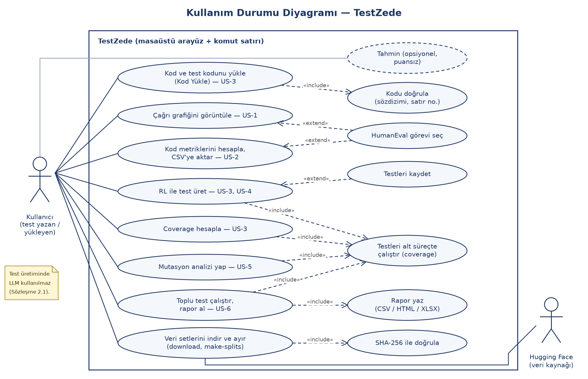

*Şekil 1 — Kullanım durumu diyagramı. US-1 … US-6 ana kullanım durumlarıdır; "Testleri alt süreçte çalıştır" coverage, RL, mutasyon ve toplu testin ortak parçasıdır.*

## 2.2 Katmanlar ve paketler

Uygulama N katmanlı mimaridedir (ARCHITECTURE §1). Sunum katmanı (`gui`, `cli`), uygulama katmanı (`services`), çekirdek paketler (`analysis`, `rl`, `execution`, `mutation`, `prediction`, `datasets`, `batch`) ve ortak paketler (`domain`, `config`, `logging_setup`) vardır. Şekil 2'deki oklar koddaki gerçek `import` bağımlılıklarından çıkarılmıştır.

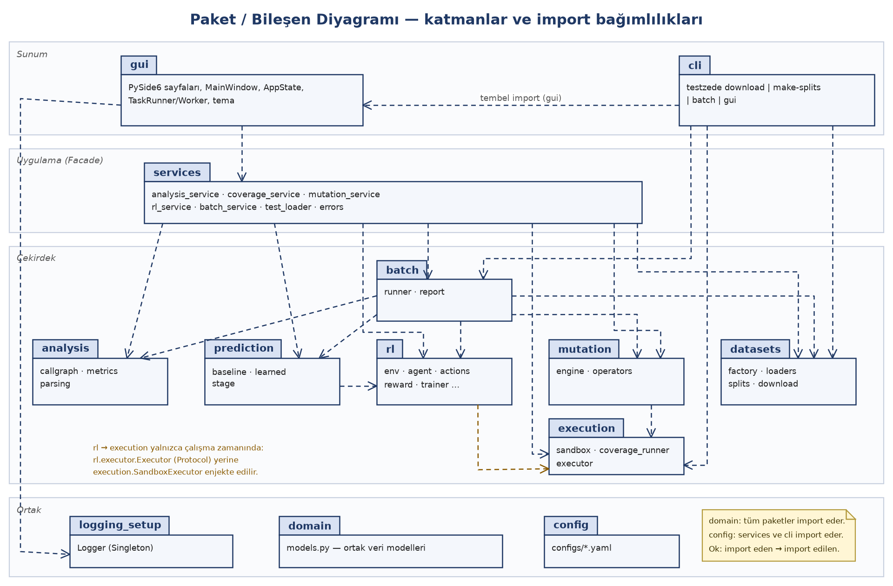

*Şekil 2 — Paket / bileşen diyagramı. GUI çalışma zamanında yalnızca `services`, `domain` ve `logging_setup`'ı import eder; çekirdek türleri yalnızca tip ipucu olarak (`TYPE_CHECKING`) görür.*

Koddan doğrulanan bağımlılık kuralları:

- `gui` çekirdeği doğrudan çağırmaz; sayfalar `services/` cephelerini kullanır. Çekirdek modül importları yalnızca `if TYPE_CHECKING:` bloklarındadır (`gui/state.py`, `gui/pages/coverage_logic.py`, `mutation_logic.py`, `coverage_page.py`, `mutation_page.py`).
- `rl` yalnızca `domain`'e bağımlıdır. Çalıştırma işi `rl/executor.py`'deki `Executor` protokolü üzerinden yapılır; gerçek uygulama (`execution.executor.SandboxExecutor`) çalışma zamanında verilir.
- `mutation` → `execution` (`coverage_runner.run_tests`, `run_outcomes`).
- `prediction` → `rl` (`CurvePoint`, `EpisodeResult` türleri).
- `batch` → `analysis`, `datasets`, `mutation`, `prediction`, `rl`; çalıştırıcı (`Executor`) dışarıdan verilir.
- `cli` → `batch`, `datasets`, `execution`, `config`; `gui`'yi yalnızca `testzede gui` komutunda (fonksiyon içinde) import eder. `cli`, `services` katmanını kullanmaz (bkz. §9 Tutarsızlıklar).

## 2.3 Çalışma zamanı yapısı

| Yürütme birimi | Ne çalışır | Kod |
|---|---|---|
| GUI iş parçacığı | Qt olay döngüsü, sayfalar, çizim | `gui/app.py`, `gui/main_window.py` |
| `QThread` (sayfa başına en fazla bir) | Uzun işler: coverage, RL, mutasyon, toplu test, analiz | `gui/worker.py` (`TaskRunner`, `Worker`) |
| İş parçacığı havuzu | Mutantların paralel koşturulması (en çok `min(6, çekirdek − 2)`, en az 1 işçi) | `mutation/engine.py` (`ThreadPoolExecutor`) |
| Alt süreç (`python -I`) | Oracle çağrısı ya da `coverage run --branch -m pytest` | `execution/sandbox.py`, `execution/coverage_runner.py` |

Her alt süreç geçici bir dizinde (`testzede_call_*`, `testzede_run_*`) çalışır, `stdin/stdout/stderr` kapalıdır, `shell` kullanılmaz ve üst süreçteki `COVERAGE_*` / `COV_CORE_*` ortam değişkenleri alt sürece geçirilmez (`sandbox.child_env`).

## 2.4 Giriş noktaları

| Giriş | Ne yapar |
|---|---|
| `testzede gui` (ya da `python -m testzede.gui`) | `gui/app.py:main` — global istisna yakalayıcıyı kurar, temayı uygular, `MainWindow`'u açar. |
| `testzede download --dataset <ad\|all>` | Veri setlerini sabit Hugging Face revizyonundan indirir, SHA-256 ile doğrular. |
| `testzede make-splits` | `data/splits/{development,main,external}.json` dosyalarını üretir. |
| `testzede batch --split … \| --dataset …` | Toplu test çalıştırır, veri seti başına rapor yazar (US-6). |

Komut satırı girişi `pyproject.toml`'daki `testzede = "testzede.cli:main"` tanımıdır. Kullanıcı kaynaklı hatalar `Hata: …` mesajıyla bildirilir ve çıkış kodu 1 olur (`cli.py`).

# 3. BİLEŞEN TASARIMI

Her paket için sorumluluk, dışarıya açık arayüz ve bağımlılıklar verilmiştir. Sınıf diyagramları Şekil 3a–3f'dedir.

## 3.1 domain — ortak veri modelleri

**Sorumluluk.** Modüller arası veri yalnızca bu modellerle taşınır (`domain/models.py`). Alan değişikliği üç ekip üyesinin onayını ister (ARCHITECTURE §2).

**Arayüz.** `CodeUnit` (değişmez), `TestCase`, `CoverageReport` (`line_rate`), `MetricSet`, `MutationReport` (`score`), `RunStats` (`compilation_rate`), `Prediction`. Oranlarda payda 0 ise sonuç 0.0'dır.

**Bağımlılık.** Yok (yalnızca standart kütüphane).

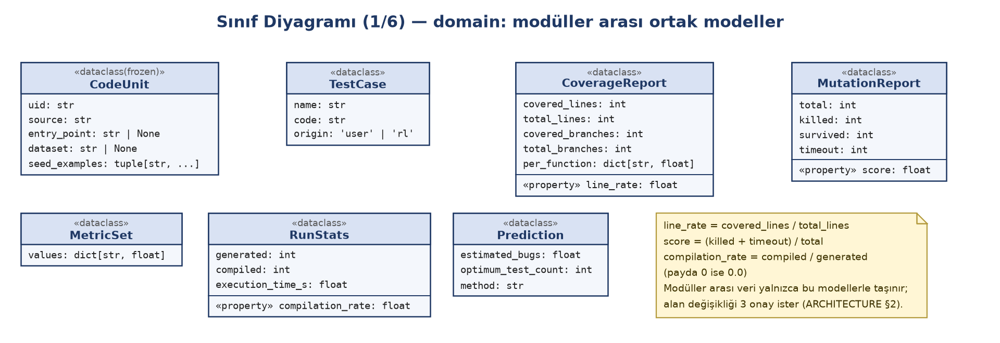

*Şekil 3a — domain modelleri. Bu sınıflar arasında ilişki yoktur; diğer paketler bunları üretir ve tüketir.*

## 3.2 execution — alt süreçte çalıştırma ve coverage (US-3, US-5)

**Sorumluluk.** Test edilen kodu ve testleri ana uygulamadan ayrı bir alt süreçte, süre sınırıyla çalıştırmak; satır ve dal kapsamasını ölçmek; derlenebilirlik ve süreyi saymak. Hiçbir fonksiyon dışarıya istisna sızdırmaz (Madde-1).

**Arayüz.**

- `sandbox.call_function(unit, args_repr, timeout=2.0) -> CallResult`: `unit.entry_point(*literal_eval(args_repr))` çağrısını alt süreçte yapar. Durum `ok`, `raised`, `timeout` ya da `error` olur. Generator fonksiyonlarında ilk `GENERATOR_LIMIT` (50) öğe tüketilir. 10 000 karakterden uzun `repr` yerine `None` döner.
- `coverage_runner.run_tests(unit, tests, timeout=10.0) -> ExecutionResult`: kaynak `target.py`, her test `test_NNNN.py` olarak geçici dizine yazılır; `python -I -m coverage run --branch --include=target.py -m pytest` çalıştırılır. JUnit XML'den test sonuçları, coverage JSON'dan satır/dal kümeleri ve fonksiyon bazlı oranlar okunur.
- `coverage_runner.run_outcomes(unit, tests, timeout=10.0)`: aynı işi coverage'sız yapar (mutasyonun hızlı yolu).
- `executor.SandboxExecutor`: `rl.executor.Executor` protokolüne yapısal olarak uyan sarmalayıcı (`call_function`, `run_tests`).

**Bağımlılık.** `domain`. Derlenebilirlik: `ast.parse` ile ayrıştırılamayan test ve pytest raporunda `error` olan test (toplama hatası, çöken süreç) derlenmemiş sayılır (bkz. §9).

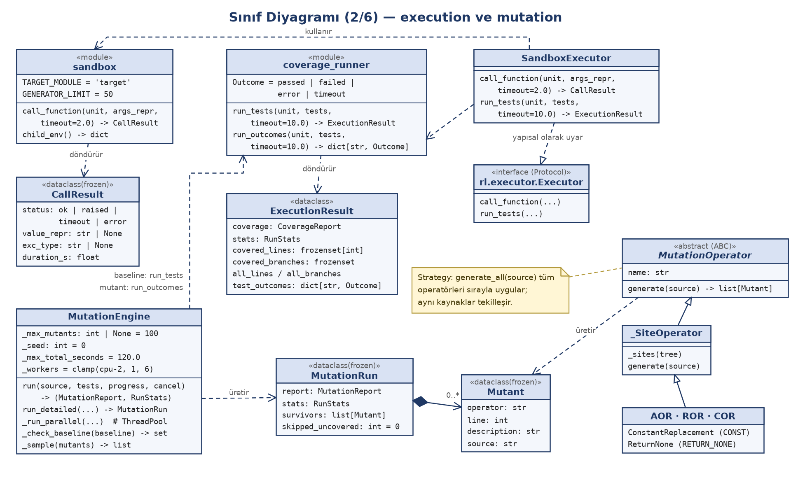

*Şekil 3b — execution ve mutation. `SandboxExecutor`, RL'nin beklediği `Executor` protokolünü kalıtım olmadan (yapısal olarak) karşılar; mutasyon operatörleri Strategy kalıbıyla `MutationOperator` arayüzünü uygular.*

## 3.3 mutation — mutasyon analizi (US-5)

**Sorumluluk.** Kendi AST tabanlı motoruyla mutant üretmek, her mutantı test paketine karşı koşturmak, öldürülen / hayatta kalan / zaman aşımı sayılarını vermek.

**Arayüz.**

- `operators.generate_all(source, operators=None) -> list[Mutant]`: tüm operatörleri uygular, aynı kaynaklı mutantları tekilleştirir. Operatörler: `AOR` (`+`↔`-`, `*`↔`/`), `ROR` (`<`↔`<=`, `>`↔`>=`, `==`↔`!=`), `COR` (`and`↔`or`), `CONST` (sabit değiştirme), `RETURN_NONE` (`return` değerini `None` yapma).
- `engine.MutationEngine(max_mutants=100, seed=0, max_total_seconds=120.0, workers=None)`; `run(...) -> (MutationReport, RunStats)`, `run_detailed(...) -> MutationRun` (hayatta kalan mutantlar ve atlanan sayısıyla).

**Akış.** (1) Kaynak ayrıştırılır. (2) Orijinal kodda testler bir kez çalıştırılır (baseline, 10 sn). Başarısız ya da zaman aşımına uğrayan test varsa ya da hiç geçen test yoksa `MutationError` verilir; orijinalde derlenemeyen testler karar dışı bırakılır. (3) Mutantlar üretilir; `max_mutants`'tan fazlaysa tohumlu rastgele örnekleme yapılır. (4) Testlerin hiç çalıştırmadığı satırdaki mutantlar koşturulmadan hayatta kalan sayılır. (5) Kalanlar iş parçacığı havuzunda `run_outcomes` ile koşturulur; mutant başına süre sınırı `max(3 sn, 5 × baseline süresi)`'dir. İptal ya da toplam süre aşımında o ana kadarki sonuç döner.

**Bağımlılık.** `domain`, `execution.coverage_runner`.

## 3.4 rl — pekiştirmeli öğrenme ile test üretimi (US-3, US-4)

**Sorumluluk.** Bir birim için, büyük dil modeli kullanmadan, tabular Q-learning ajanının seçtiği girdi stratejileriyle pytest testleri üretmek ve coverage'ı artırmak.

**Arayüz ve bileşenler.**

| Bileşen | Sınıf / fonksiyon | Tasarım |
|---|---|---|
| Ortam | `env.TestGenEnv` | gymnasium'a benzer `reset()` / `step()` API'si; gymnasium'a bağımlı değildir. Her adımda yalnızca yeni test çalıştırılır, kapsanan satır/dal kümeleri ortamda birleştirilir. |
| Durum | `state.State`, `discretize`, `state_index` | (satır dilimi, dal dilimi, son adım geçerli mi, adım dilimi); `bins = 5` ile 5 × 5 × 2 × 5 = 250 durum. |
| Eylemler | `actions.Action` alt sınıfları, `ACTION_REGISTRY` | 8 strateji: `BOUNDARY`, `EMPTY`, `NEGATIVE`, `RANDOM_SMALL`, `RANDOM_LARGE`, `SPECIAL_CHARS`, `FROM_DOCSTRING`, `MUTATE_BEST`. |
| Ödül | `reward.compute_reward`, `RewardWeights` | `α·Δsatır + β·Δdal + γ·yeni_çıktı_sınıfı − δ·geçersiz − ε`; varsayılanlar α=1.0, β=2.0, γ=0.5, δ=1.0, ε=0.05. |
| Ajan | `agent.QLearningAgent` | ε-greedy (ε=0.2), α=0.1, γ=0.9; eşit Q değerlerinde rastgele seçim. |
| Test sentezi | `synthesizer.synthesize` | Girdi oracle'da çalıştırılır; sonuç `assert` olarak yazılır, istisna fırlatan girdi `pytest.raises` testine dönüşür. |
| Eğitim | `trainer.generate_tests`, `run_episode`, `RLConfig` | `config.episodes` epizot oynatılır; en iyi epizot (önce dal, sonra satır coverage, sonra az test) seçilir. |
| Çalıştırıcı sözleşmesi | `executor.Executor` (Protocol) | `call_function`, `run_tests`; gerçek uygulama `execution.SandboxExecutor`. |

**Bitiş koşulu.** Tam coverage (dal varsa tüm dallar, yoksa tüm satırlar), `max_steps` adım ya da `patience` adım boyunca artış olmaması. Kullanıcı testleri zaten tam kapsıyorsa epizot adım atmadan biter.

**Kullanıcı testleriyle artırım (US-3).** Kullanıcı test dosyası verilirse ortam her epizoda bu testlerin coverage'ıyla başlar; dönen `tests` yalnızca RL'nin eklediği testlerdir. Sonuç hem "kullanıcı testleri" hem "kullanıcı testleri + RL" coverage'ını verir (`GenerationResult.baseline`, `coverage`).

**Bağımlılık.** `domain`; NumPy (Q tablosu).

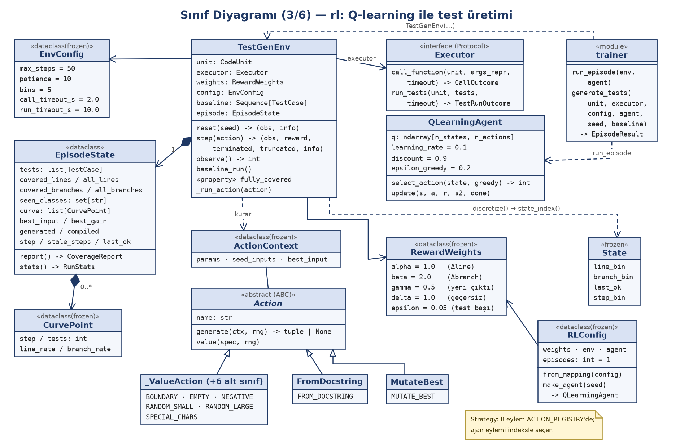

*Şekil 3c — rl paketi. `TestGenEnv`, `Executor` protokolüne bağımlıdır; eylemler Strategy kalıbıyla `Action` arayüzünü uygular.*

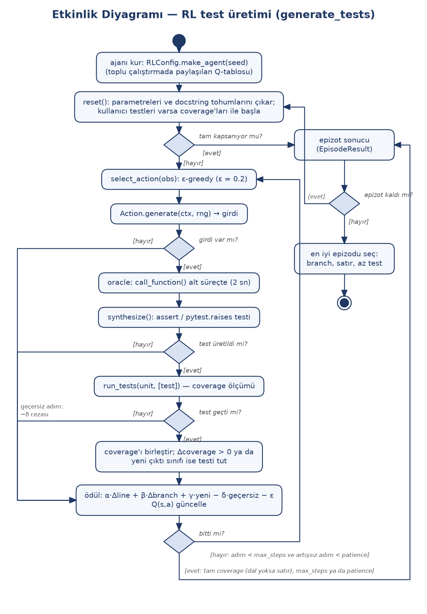

*Şekil 5 — `generate_tests` etkinlik diyagramı. Geçersiz adımlar (girdi yok, test üretilmedi, test geçmedi) ödülde −δ cezası alır ve adım sayılır.*

## 3.5 analysis — çağrı grafiği ve metrikler (US-1, US-2)

**Sorumluluk.** `callgraph.build_call_graph(source)`: `ast` ile tanımları ve çağrıları çıkarır, `networkx.DiGraph` döndürür; yerleşik çağrılar `<builtin>.ad`, dış çağrılar `<external>.ad`, modül düzeyi `<module>` olarak etiketlenir. `metrics.compute_metrics(source)`: radon ile 14 metrik üretir (LOC, LLOC, SLOC, Yorum, Çoklu Satır, Boş Satır, Halstead Zorluk/Çaba/Uzunluk/Zaman/Kelime Haznesi/Hacim, Çevrimsel Karmaşıklık, Sürdürülebilirlik İndeksi); `maintainability_rank` A/B/C derecesini verir. `parsing.parse_python`: söz dizimi hatası, null bayt, aşırı iç içe yapı ve bellek hatalarını satır numaralı `SourceError`'a çevirir.

**Bağımlılık.** `domain`; networkx, radon.

## 3.6 prediction — tahmin (opsiyonel, puansız)

**Sorumluluk.** `baseline.predict_baseline(metrics)`: Halstead teslim edilen hata `B = V / 3000`, McCabe karmaşıklığı optimum (bağımsız yol) test sayısı. `baseline.knee_point(curve)`: coverage eğrisinin diz noktası. `learned.LearnedPredictor`: scikit-learn regresyonu; v0.3.1'de eğitilmiş model yoktur (ARCHITECTURE §3). `stage.prediction_stage()`: toplu çalıştırmaya takılan aşama.

**Bağımlılık.** `domain`, `rl` (eğri ve epizot türleri); scikit-learn.

## 3.7 datasets — veri setleri ve ayrımlar (US-6, Yardımcı)

**Sorumluluk.** Veri setlerini indirmek, doğrulamak, birimlere çevirmek ve sızıntısız ayırmak.

**Arayüz.**

- `factory.DatasetFactory.get(name, data_dir) -> DatasetLoader` (Factory; `register`, `names`).
- `base.DatasetLoader` (soyut): `load() -> LoadResult`, `source_files()`, `__iter__()`. Alt sınıflar: `HumanEvalLoader` (`humaneval`), `Small67Loader` (`small67`), `TestGenEvalLoader` (`testgeneval`), `TestGenEvalLiteLoader` (`testgeneval-lite`).
- `LoadResult`: birimler, atlanan örnekler (`SkippedUnit`, neden koduyla) ve sayaçlar; hiçbir örnek sessizce kaybolmaz.
- `extraction.extract_functions(source)`: TestGenEval dosyalarından tek başına çalışabilen fonksiyonları, ihtiyaç duydukları import, sabit ve yardımcılarla çıkarır; reddedilenleri neden koduyla sayar.
- `download.download_dataset(name, data_dir)`: sabit revizyondan indirir, SHA-256 ile doğrular; doğru dosya varsa yeniden indirmez.
- `splits.build_splits`, `write_splits`, `verify_no_leakage`, `load_split_units`: `development` (TestGenEvalLite), `main` (TestGenEval eksi Lite, `instance_id` ile), `external` (HumanEval + Small67).

**Bağımlılık.** `domain`; pyarrow (parquet), openpyxl (Small67), yalnızca standart kütüphane ile indirme.

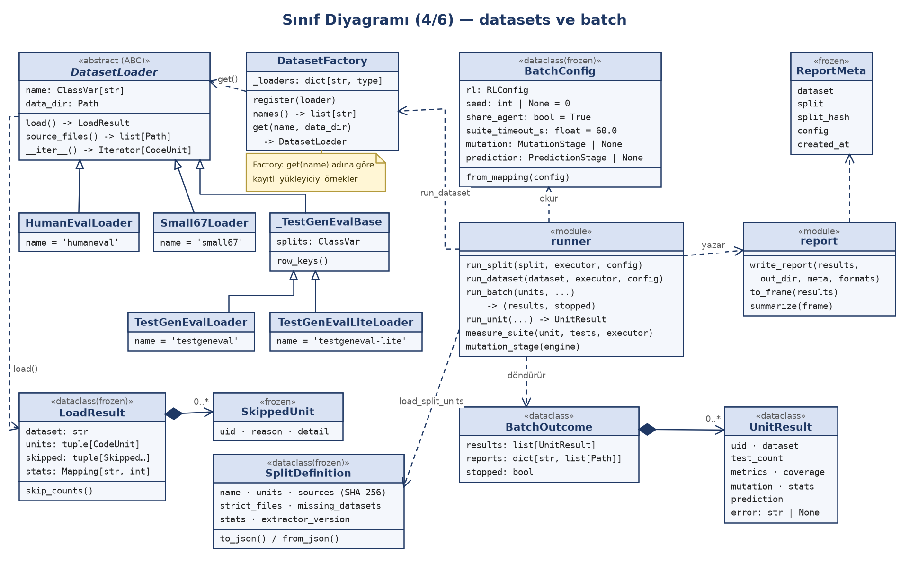

*Şekil 3d — datasets ve batch. `DatasetFactory` adına göre yükleyici örnekler; `runner` hattı çalıştırır ve `report` veri seti başına rapor yazar.*

## 3.8 batch — toplu çalıştırma ve rapor (US-6)

**Sorumluluk.** Her birim için metrik → RL → coverage ölçümü → mutasyon → (opsiyonel) tahmin hattını çalıştırmak ve veri seti bazında rapor yazmak.

**Arayüz.**

- `runner.run_split(split, executor, config, …)`, `run_dataset(dataset, executor, config, …)` → `BatchOutcome` (sonuçlar, yazılan rapor yolları, durduruldu mu).
- `runner.run_batch(units, executor, config, progress, should_stop)`: birimleri sırayla çalıştırır; `should_stop` her birimden önce sorulur. `i`. birim `seed + i` tohumunu kullanır; `share_agent` ise Q tablosu birimler arasında paylaşılır.
- `runner.run_unit(...) -> UnitResult`: istisna fırlatmaz; bir aşama hata verirse hata `UnitResult.error`'a yazılır, önceki aşamaların sonuçları korunur.
- `runner.measure_suite(...)`: coverage ve test çalıştırma süresi, seçilen test paketinin bir kez baştan çalıştırılmasıyla ölçülür. Derlenebilirlik, RL'nin ürettiği tüm testler (seçilmeyenler dahil) üzerindendir.
- `BatchConfig.from_mapping(config)`: `configs/*.yaml`'ın `batch`, `reward`, `agent`, `sandbox` bölümlerinden kurulur; `mutation: true` ise `mutation_stage()`, `prediction: true` ise `prediction_stage()` takılır.
- `report.write_report(results, out_dir, meta, formats)`: `results.csv`, `summary.csv`, `meta.csv`, `report.xlsx`, `report.html`.
- Birim sınırı (`limit`) **veri seti başına** uygulanır (`_select`); STD 3.8 test kaydındaki notla tutarlıdır.

**Bağımlılık.** `analysis`, `datasets`, `mutation`, `prediction`, `rl`, `domain`; pandas, Jinja2, openpyxl.

## 3.9 services — uygulama katmanı (Facade)

**Sorumluluk.** GUI'ye çekirdeğin sade bir alt kümesini sunmak, girdileri doğrulamak ve çekirdek hatalarını kullanıcıya gösterilebilir `ServiceError` mesajına çevirmek.

| Cephe | Ana çağrılar | Çekirdekte kullandığı |
|---|---|---|
| `analysis_service.AnalysisService` | `call_graph`, `metrics`, `prediction`, `export_metrics_csv`, `humaneval_tasks` | `analysis`, `prediction.baseline`, `datasets` (HumanEval listesi) |
| `coverage_service.CoverageService` | `run(source, tests, timeout=10.0)` | `execution.coverage_runner.run_tests` |
| `mutation_service.MutationService` | `run`, `run_detailed`; `create_mutation_service(max_mutants=100)` | `mutation.engine.MutationEngine` (Protocol üzerinden) |
| `rl_service` | `list_functions`, `build_unit`, `load_rl_config`, `generate`, `tests_module` | `rl.trainer`, `execution.SandboxExecutor`, `batch.runner.measure_suite`, `config` |
| `batch_service` | `targets(data_dir)`, `run(target, …)` | `batch.runner`, `datasets`, `config`, `execution.SandboxExecutor` |
| `test_loader` | `load_tests(test_source, module_name)` | `execution.sandbox.TARGET_MODULE` |

Kaynak modül adı verildiğinde test dosyasındaki `from <modül> import …` satırları `target`'a yönlendirilir (`test_loader`, `rl_service._ImportRewriter`). Yapılandırma `configs/frozen.yaml`'dan, o yoksa `configs/default.yaml`'dan okunur.

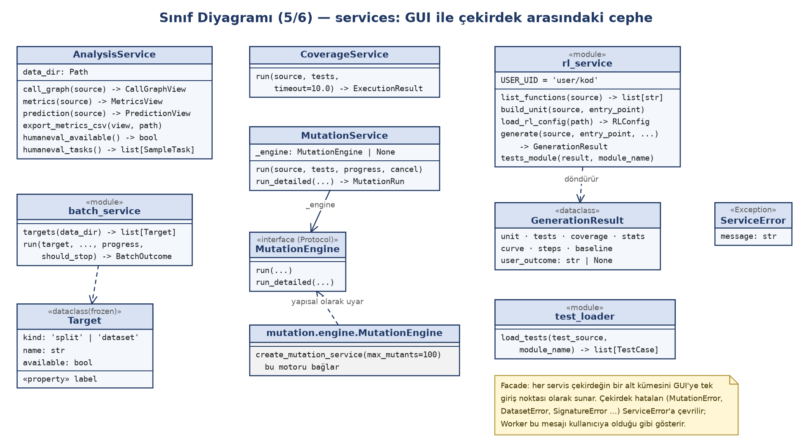

*Şekil 3e — services cepheleri. `MutationService` motoru bir protokol üzerinden tutar; gerçek motoru `create_mutation_service` bağlar.*

## 3.10 gui — masaüstü arayüz

**Sorumluluk.** Sayfaları göstermek, kullanıcı girdisini doğrulamak, uzun işleri arka planda çalıştırmak ve sonuçları göstermek.

**Ana sınıflar.** `MainWindow` (solda 200 px sayfa listesi, sağda `QStackedWidget`, sağ üstte tema düğmesi; pencere 1200 × 780 açılır), `AppState` (sayfalar arası paylaşılan kaynak, testler, son coverage ve mutasyon sonucu), `BasePage` (`title`, `on_enter`), `AnalysisPage` (Çağrı Grafiği, Metrikler ve Tahmin sayfalarının ortak tabanı: `_compute` ve `_render` kancaları), `TaskRunner` / `Worker` (QThread işleri), `ThemeSwitch`, `error_handler` (global `sys.excepthook`).

**Yaşam döngüsü.** Sayfa seçilince `on_enter()` çağrılır. Pencere kapanırken her sayfanın `shutdown()`'ı çağrılır; çalışan iş durdurma isteği alır ve beklenir (bekleme sınırları §7.2'de).

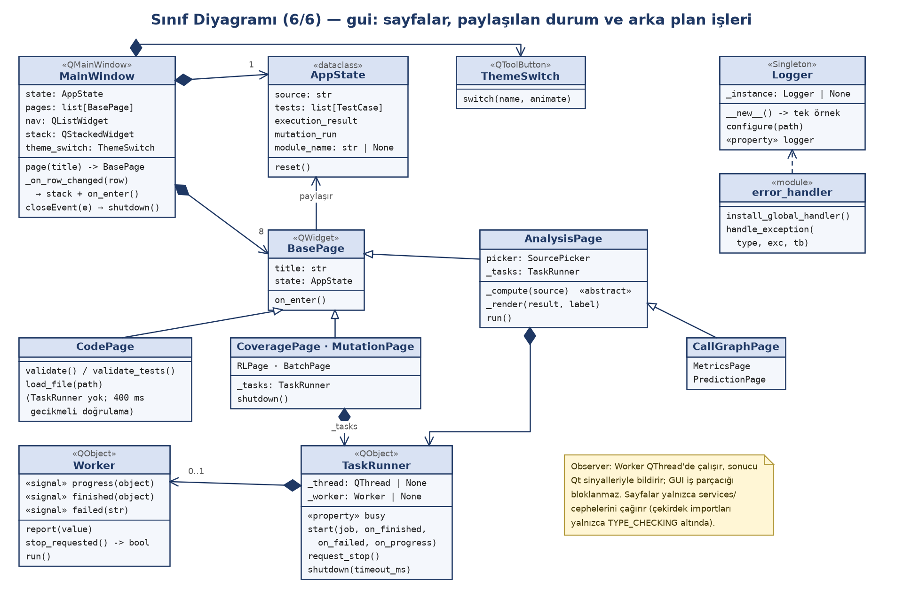

*Şekil 3f — gui sınıfları. Arka planda iş çalıştıran sayfalar bir `TaskRunner` sahibidir; `CodePage` doğrulamayı GUI iş parçacığında, 400 ms gecikmeyle yapar.*

## 3.11 cli, config ve logging_setup

- `cli.py`: `download`, `make-splits`, `batch`, `gui` alt komutları (argparse). `batch` ilerlemeyi satır satır yazar; `--split`/`--dataset`, `--only`, `--limit`, `--formats`, `--config` seçenekleri vardır.
- `config.py`: `default_config_path()` (`frozen.yaml` varsa o), `load_config(path)` (YAML → eşleme; bozuk dosyada `ConfigError`).
- `logging_setup.Logger`: Singleton; `~/.testzede/logs/testzede.log` dosyasına UTF-8, 1 MB × 3 dönen log yazar; dosya açılamazsa konsola düşer.

# 4. VERİ VE DOSYA YAPILARI

## 4.1 Bellek içi modeller

Paketler arası veri `domain/models.py`'deki modellerle taşınır (§3.1). Paket içi sonuç türleri: `CallResult`, `ExecutionResult` (execution); `Mutant`, `MutationRun` (mutation); `EpisodeState`, `CurvePoint`, `EpisodeResult`, `State` (rl); `LoadResult`, `SkippedUnit`, `SplitDefinition` (datasets); `UnitResult`, `ReportMeta`, `BatchOutcome` (batch); `CallGraphView`, `MetricsView`, `PredictionView`, `GenerationResult`, `Target` (services); `AppState` (gui).

## 4.2 Yapılandırma dosyaları

`configs/default.yaml` başlangıç ayarlarıdır; `configs/frozen.yaml` development split'inde yapılan ayar taramasının sonucudur ve varsa otomatik kullanılır.

| Anahtar | default.yaml | frozen.yaml | Kullanan |
|---|---|---|---|
| `reward.alpha / beta / gamma / delta / epsilon` | 1.0 / 2.0 / 0.5 / 1.0 / 0.05 | aynı | `RewardWeights` |
| `agent.learning_rate / discount / epsilon_greedy` | 0.1 / 0.9 / 0.2 | aynı | `AgentConfig` |
| `agent.max_steps` | 50 | 50 | `EnvConfig` |
| `agent.patience` | 10 | 20 | `EnvConfig` |
| `agent.episodes` | — (1) | 3 | `RLConfig` |
| `sandbox.timeout_s` | 10 | 10 | `EnvConfig.run_timeout_s` |
| `batch.seed / share_agent` | 0 / true | 0 / true | `BatchConfig` |
| `batch.suite_timeout_s` | 60 | 60 | `measure_suite` |
| `batch.mutation` | true | true | `mutation_stage` |

Bilinmeyen anahtar `ValueError` ile reddedilir (`RLConfig.from_mapping`, `BatchConfig.from_mapping`).

## 4.3 Veri dizinleri

| Yol | İçerik |
|---|---|
| `data/raw/humaneval/test.parquet` | HumanEval (164 görev) |
| `data/raw/testgeneval-lite/{test,dev}.parquet` | TestGenEvalLite |
| `data/raw/testgeneval/test.parquet` | TestGenEval |
| `data/raw/small67/*.xlsx` | 67_Python_Code_Small (ders sorumlusundan) |
| `data/splits/{development,main,external}.json` | Ayrım dosyaları |

`data/raw/*`, `data/splits/*` ve `reports/*` `.gitignore`'dadır; veri setleri depoya eklenmez (Sözleşme 4.4).

Ayrım dosyası alanları (`SplitDefinition.to_json`): `schema_version` (1), `extractor_version` (2), `name`, `leakage_key` (`instance_id`), `strict_files`, `missing_datasets`, `sources` (ham dosya → SHA-256), `units` (veri seti → `uid` listesi), `stats` (sayaçlar, atlanma nedenleri ve sızıntı istatistikleri). JSON sıralı ve zaman damgasızdır; aynı veriden aynı baytlar çıkar. Ham dosyanın özeti değişmişse `load_split_units` hata verir.

`uid` biçimleri: `HumanEval/12`, `small67/<satır>`, `<instance_id>::<dosya>::<fonksiyon>`.

## 4.4 Rapor çıktıları

`reports/<YYYY-MM-DD>/<veri_seti>/`:

- `results.csv`: birim başına bir satır — `uid`, `dataset`, `status` (`ok`/`error`), `tests`, `line_coverage`, `branch_coverage`, `mutation_score`, `mutants`, `mutants_killed`, `mutants_survived`, `compilation_rate`, `execution_time_s`, `estimated_bugs`, `optimum_tests`, 14 metrik sütunu ve `error`. Çalışmayan aşamanın sütunları boş kalır.
- `summary.csv`: veri seti başına birim sayısı, hatalı birim sayısı, toplam/ortalama test sayısı ve ortalama oranlar.
- `meta.csv`: split adı, split dosyasının SHA-256'sı, yapılandırma dosyası, tarih.
- `report.xlsx`, `report.html`: aynı içeriğin tablo ve sayfa biçimi.

Biçimler `--formats` ile seçilir (`csv`, `html`, `xlsx`); rapor kökü `--reports-dir` ile değiştirilebilir.

## 4.5 Geçici çalışma alanı ve log

- Oracle: `testzede_call_*/target.py`, `runner.py`, `out.json` (sonuç stdout yerine dosyaya yazılır, çünkü hedef kod `print` edebilir).
- Test çalıştırma: `testzede_run_*/target.py`, `test_0000.py …`, `report.xml` (JUnit), coverage JSON.
- Log: `~/.testzede/logs/testzede.log` (§3.11).

# 5. ARAYÜZ TASARIMI

## 5.1 Ekranlar

Sayfalar soldaki listede ARCHITECTURE §6'daki sırayla yer alır (`gui/main_window.py`, `PAGES`).

| Sayfa | İçerik ve denetimler | Kullandığı servis | US / STD |
|---|---|---|---|
| Kod Yükle | "Kaynak Kod" ve "Test Kodu" sekmeleri; "Dosya Aç", "Doğrula"; yazarken 400 ms gecikmeli doğrulama; yeşil/kırmızı durum mesajı | `test_loader` | US-3 / 3.1, 3.2 |
| Çağrı Grafiği | Kaynak seçici (Kod Yükle kodu ya da HumanEval görevi), "Grafiği Oluştur", grafik + düğüm tablosu + ayrıntı, matplotlib araç çubuğu | `AnalysisService` | US-1 / 3.3 |
| Metrikler | Kaynak seçici, "Metrikleri Hesapla", 14 metrik tablosu ve açıklamaları, sürdürülebilirlik derecesi, "CSV'ye Aktar…" | `AnalysisService` | US-2 / 3.4 |
| Coverage | "Çalıştır"; satır/dal/derlenme/süre özeti; renkli kaynak görünümü (kapsanan, kısmi, kaçan); "Fonksiyonlar" (Fonksiyon, Kapsama %) ve "Test Sonuçları" (Test, Sonuç) tabloları | `CoverageService` | US-3 / 3.5 |
| RL Test Üretimi | Kendi kaynak editörü ve "Kullanıcı testleri (opsiyonel)" sekmesi; "Kod Aç…", "Test Dosyası Aç…", fonksiyon seçimi, "Testleri Üret", "Testleri Kaydet…"; üretilen test listesi; alt şerit: Test Case Statistics, Branch Count, Tested Line Count, Coverage Rate | `rl_service` | US-3, US-4 / 3.6 |
| Mutasyon | En fazla mutant sayısı (varsayılan 100), "Çalıştır", "İptal", ilerleme çubuğu; skor, öldürülen, hayatta kalan, zaman aşımı, atlanan, derlenme, süre; hayatta kalan mutant tablosu ve fark görünümü | `MutationService` | US-5 / 3.7 |
| Toplu Test | Hedef (split ya da veri seti; diskte yoksa "bulunamadı"), "Yenile", birim sınırı, CSV/HTML/XLSX kutuları, "Başlat", "Durdur", "Rapor Klasörünü Aç", ilerleme çubuğu, canlı sonuç tablosu | `batch_service` | US-6 / 3.8 |
| Tahmin | Kaynak seçici, temel tahmin (hata sayısı, optimum test sayısı, yöntem) | `AnalysisService` | Opsiyonel / test edilmez |

## 5.2 Tema ve stil

`gui/theme.py` uygulama temasını renk, yazı tipi ve boşluk değerlerinden üretir. Tema `TESTZEDE_THEME` ortam değişkeniyle seçilir: boş ya da `light` açık tema (varsayılan), `dark` koyu tema, `material` eski qt-material `light_blue` teması (geri dönüş yolu). Stil Fusion'dır; boşluklar `SpacingStyle` (`QProxyStyle`) ile verilir, böylece sayfa kodu değişmeden her sayfaya uygulanır. Boşluk ölçeği 4/8/12/16/24 px, denetim köşe yarıçapı 8 px, kart 12 px, en küçük denetim yüksekliği 32 px'tir. Sağ üstteki `ThemeSwitch` açık ve koyu tema arasında geçiş yapar (material temasında gizlidir). Kod editörlerinde eş aralıklı yazı tipi kullanılır (`styles.MONO_FAMILIES`).

## 5.3 Kullanılabilirlik ve erişilebilirlik kararları (kodda olanlar)

- **Kontrast.** Tema renklerindeki ana yazı/zemin çiftleri WCAG AA (≥ 4.5:1) hedefiyle seçilmiştir (`theme.Theme` açıklaması). Durum renkleri (geçti, hata, uyarı; kapsanan, kısmi, kaçan) açık ve koyu tema için ayrı tanımlıdır, yazı ve zemin birlikte verilir (`styles.status_colors`).
- **Renk körlüğü.** Çağrı grafiğinde düğüm türleri renk ve şekille birlikte ayrılır; Okabe-Ito paleti kullanılır (`graph_canvas.py`).
- **Yalnızca renge dayanmama.** Test sonuçları metinle de yazılır ("Geçti", "Başarısız", "Hata", "Zaman aşımı").
- **Önleyici geri bildirim.** Kaynak kod yokken analiz sayfalarında çalıştırma düğmesi kapalıdır ve nedeni yazılır; HumanEval indirilmemişse seçenek kapalıdır ve ipucu indirme komutunu söyler.
- **Hata mesajları.** Sözdizimi hatası satır numarasıyla gösterilir, önceki geçerli kod korunur.
- **Eski sonuç uyarısı.** Kaynak ya da testler değişince sayfa "bu sonuç eski olabilir" notunu gösterir.
- **Yanıt veren arayüz.** Uzun işlemler `QThread`'de çalışır; ilerleme çubuğu, "İptal" (Mutasyon) ve "Durdur" (Toplu Test) vardır.
- **Erişilebilir ad ve ipuçları.** Tema düğmesi araç ipucu ve erişilebilir ad taşır (`setAccessibleName`); Çağrı Grafiği, Metrikler, Coverage, Toplu Test ve Tahmin sayfalarında araç ipuçları vardır.

Kodda klavye kısayolu (`QShortcut`) tanımı yoktur; bu doküman böyle bir özellik iddia etmez.

## 5.4 Komut satırı arayüzü

| Komut | Önemli seçenekler | Çıktı |
|---|---|---|
| `testzede download` | `--dataset {humaneval, testgeneval-lite, testgeneval, all}`, `--force` | `data/raw/<veri_seti>/`, SHA-256 doğrulaması |
| `testzede make-splits` | `--strict-files`, `--allow-missing` | `data/splits/*.json`, her dosya için SHA-256 |
| `testzede batch` | `--split` ya da `--dataset` (biri zorunlu), `--only`, `--limit` (veri seti başına), `--formats`, `--config`, `--reports-dir` | `reports/<tarih>/<veri_seti>/` |
| `testzede gui` | — | masaüstü arayüz |

`download`, `make-splits` ve `batch` komutları `--data-dir` (varsayılan `data`) alır.

## 5.5 Paketler arası arayüzler

| Arayüz | Sağlayan | Kullanan | Sözleşme |
|---|---|---|---|
| `rl.executor.Executor` (Protocol) | `execution.SandboxExecutor` | `rl.env`, `batch.runner`, `services` | `call_function(unit, args_repr, timeout)`, `run_tests(unit, tests, timeout)`; istisna fırlatmaz |
| `services.mutation_service.MutationEngine` (Protocol) | `mutation.engine.MutationEngine` | `MutationService` | `run`, `run_detailed`; ilerleme `(biten, toplam)` |
| `MutationStage`, `PredictionStage` (çağrılabilir) | `runner.mutation_stage`, `prediction.stage.prediction_stage` | `runner.run_unit` | `(unit, tests) -> MutationReport`, `(unit, metrics, episode) -> Prediction` |
| `Progress`, `StopFlag` geri çağrıları | GUI `Worker` (`report`, `stop_requested`) | `runner.run_batch` | `(biten, toplam, UnitResult)`, `() -> bool` |
| `Worker` sinyalleri | `gui.worker.Worker` | Sayfalar | `progress(object)`, `finished(object)`, `failed(str)` |
| `ServiceError` | `services/*` | `Worker`, sayfalar | `message`: kullanıcıya olduğu gibi gösterilen Türkçe metin |

## 5.6 Etkileşim akışları

Uçtan uca hattın (test üretimi → alt süreçte çalıştırma → coverage → mutasyon → rapor) tamamı otomatik olarak toplu çalıştırmada (`run_unit`) işler (Şekil 4a). Arayüzde bu adımlar ayrı sayfalardadır: Kod Yükle'de yüklenen kullanıcı kodu ve testleri `AppState` üzerinden Coverage ve Mutasyon sayfalarına geçer (Şekil 4b). RL Test Üretimi sayfasının kendi kaynak editörü vardır ve `AppState`'i kullanmaz; üretilen testler "Testleri Kaydet…" ile dosyaya yazılır.

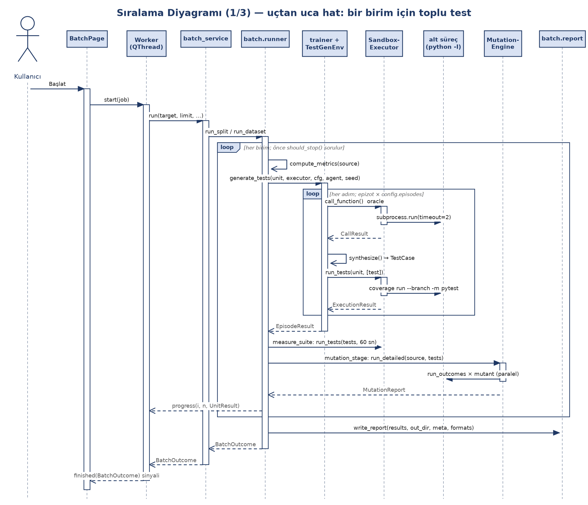

*Şekil 4a — Bir birim için uçtan uca hat. İç döngü RL adımlarıdır; her adımda oracle ve test çalıştırma ayrı alt süreçtedir.*

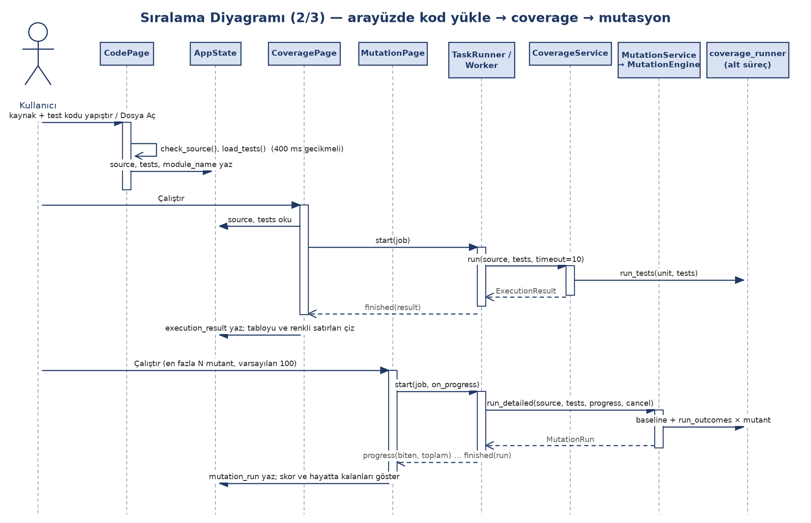

*Şekil 4b — Arayüzde kod yükle → coverage → mutasyon. Sonuçlar `AppState`'e yazılır, iş `TaskRunner`/`Worker` ile arka planda yapılır.*

# 6. TASARIM KALIPLARI VE GEREKÇELERİ

ARCHITECTURE §5'teki kalıplar kodda aşağıdaki yerlerde uygulanmıştır. Son iki satır ARCHITECTURE tablosunda yoktur ama kodda vardır.

| Kalıp | Uygulandığı yer (kod) | Gerekçe |
|---|---|---|
| N katmanlı mimari | `gui` → `services` → çekirdek → `domain` (Şekil 2) | Ekip paralel çalışabilsin; arayüz değişikliği çekirdeği etkilemesin. GUI çekirdeği yalnızca tip ipucu olarak import eder. |
| Facade | `services/analysis_service.py`, `coverage_service.py`, `mutation_service.py`, `rl_service.py`, `batch_service.py` | GUI'ye sade bir giriş noktası; `ast`/`networkx`/`radon` türlerinin GUI'ye sızmaması (`CallGraphView`, `MetricsView`); hata mesajlarının tek yerde Türkçeleştirilmesi (`ServiceError`). |
| Strategy | RL eylemleri: `rl/actions.py` (`Action` ve 8 alt sınıf, `ACTION_REGISTRY`); mutasyon operatörleri: `mutation/operators.py` (`MutationOperator`, `AOR`, `ROR`, `COR`, `ConstantReplacement`, `ReturnNone`) | Ajan eylemi bir indeksle seçer, eylemin nasıl girdi ürettiğini bilmez; yeni strateji ya da operatör eklemek mevcut kodu değiştirmez. |
| Factory | `datasets/factory.py` (`DatasetFactory.register/get`) | Veri seti adı → yükleyici eşlemesi tek yerde; CLI, batch ve servisler yükleyicinin sınıfını bilmez. |
| Observer | `gui/worker.py`: `Worker` sinyalleri (`progress`, `finished`, `failed`), sayfalardaki yuvalar | Uzun işler `QThread`'de çalışır, sonuç ve ilerleme sinyalle gelir; GUI iş parçacığı bloklanmaz. |
| Singleton | `logging_setup.Logger` (`__new__` tek örnek döndürür) | Uygulama genelinde tek log yapılandırması; `error_handler` ve tema aynı log'a yazar. |
| Bağımlılık enjeksiyonu (Protocol ile) | `rl.executor.Executor` ← `execution.SandboxExecutor`; `services.mutation_service.MutationEngine` ← `mutation.engine.MutationEngine` | `rl` çalıştırma koduna import ile bağlanmaz; birim testlerinde sahte çalıştırıcı verilebilir. |
| Template Method | `gui/pages/analysis_common.AnalysisPage.run` → alt sınıfların `_compute` / `_render`'ı; `mutation/operators._SiteOperator.generate` → alt sınıfların `_sites`'ı | Arka plan işi, hata gösterimi ve eski sonuç notu bir kez yazılır; alt sınıflar yalnızca farklı olan adımı tanımlar. |

ARCHITECTURE §5 `config.Settings` için de Singleton yazar; kodda böyle bir sınıf yoktur (yapılandırma `config.load_config` fonksiyonuyla okunur). Bu fark §9'da listelenmiştir.

# 7. HATA VE SINIR DURUMLARI

## 7.1 Hata yönetimi ilkesi

Test edilen koddaki ya da kullanıcı girdisindeki hiçbir hata uygulamayı düşürmez (Sözleşme 7.4, EK-C; kodda "Madde-1" diye anılır). Katmanlar:

1. **Alt süreç.** `sandbox.call_function` ve `coverage_runner.run_tests/run_outcomes` hiçbir koşulda istisna fırlatmaz; zaman aşımı ve çökme sonuç içinde döner.
2. **Çekirdek.** `batch.runner.run_unit` her aşamanın hatasını yakalar ve `UnitResult.error`'a yazar; toplu çalıştırma bir sonraki birimle sürer.
3. **Servis.** Girdi doğrulama ve çekirdek hataları `ServiceError`'a çevrilir.
4. **Arka plan işi.** `Worker.run`, `ServiceError` mesajını olduğu gibi, diğer istisnaları `Beklenmeyen hata: …` olarak `failed` sinyaliyle bildirir ve log'a yazar.
5. **Global.** `error_handler.handle_exception`, GUI iş parçacığında yakalanmamış istisnayı log'a yazar ve "Beklenmeyen Hata" mesaj kutusunu gösterir; uygulama açık kalır.

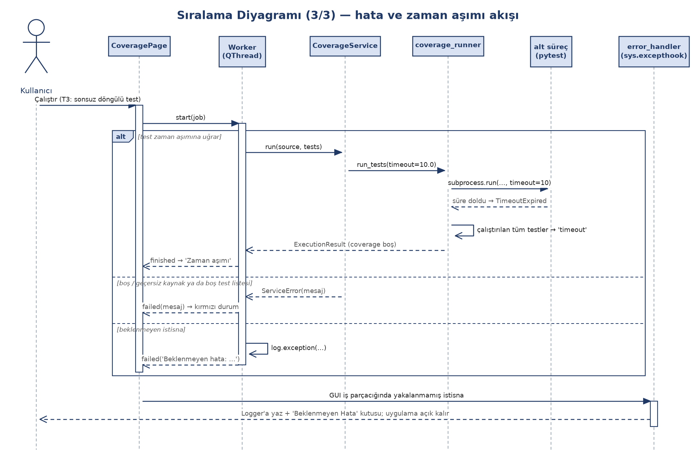

*Şekil 4c — Hata ve zaman aşımı akışı. Üç alternatif: test zaman aşımı, servis hatası, beklenmeyen istisna; en altta global yakalayıcı.*

## 7.2 Zaman aşımları ve limitler

| Sınır | Değer | Nerede |
|---|---|---|
| Oracle çağrısı | 2 sn | `EnvConfig.call_timeout_s`, `sandbox.call_function` |
| Test çalıştırma (bir `run_tests` çağrısı) | 10 sn | `coverage_runner` varsayılanı, `CoverageService.DEFAULT_TIMEOUT`, `sandbox.timeout_s` → `EnvConfig.run_timeout_s` |
| Seçilen test paketinin son çalıştırması | 60 sn | `batch.suite_timeout_s`, `rl_service.generate(suite_timeout_s=60.0)` |
| Mutasyon baseline | 10 sn | `mutation.engine.BASELINE_TIMEOUT` |
| Mutant başına | `max(3 sn, 5 × baseline süresi)` | `MutationEngine.run_detailed` |
| Mutasyon toplam süresi | 120 sn (aşılırsa o ana kadarki sonuç) | `MutationEngine(max_total_seconds=120.0)` |
| En fazla mutant | 100 (fazlası tohumlu örneklenir) | `MutationEngine`, Mutasyon sayfası |
| Paralel mutant işçisi | `max(1, min(6, çekirdek − 2))` | `mutation.engine._default_workers` |
| RL adım / sabır / epizot | 50 / 20 / 3 (`frozen.yaml`; `default.yaml`'da sabır 10, epizot 1) | `EnvConfig`, `RLConfig` |
| Generator tüketimi | ilk 50 öğe | `GENERATOR_LIMIT` |
| Oracle çıktısı | `repr` 10 000 karakteri aşarsa `None` | `sandbox._MAX_REPR` |
| Toplu test birim sınırı | veri seti başına ilk N birim | `runner._select`, `--limit`, Toplu Test "birim sınırı" |
| Pencere kapanırken bekleme | Analiz ve Coverage 15 sn, Mutasyon 30 sn, Toplu Test 60 sn, RL 30 sn | `shutdown()` çağrıları |
| Log dosyası | 1 MB × 3 dönen dosya | `logging_setup` |

STD 3.8 test kaydındaki "birim sınırı veri seti başına uygulanır; `external` için sınır 5 ile 10 birim çalışır" notu, `_select`'in davranışıyla aynıdır.

## 7.3 Zaman aşımı davranışı

`run_tests` tüm testleri **tek bir** pytest alt sürecinde çalıştırır. Süre aşılırsa süreç sonlandırılır ve o çalıştırmadaki tüm çalıştırılabilir testler `timeout` işaretlenir; coverage verisi okunamadığı için boş döner. STD 3.5 test kaydındaki "aynı çalıştırmadaki diğer testler de 'Zaman aşımı' görünüyor (tek sandbox süreci)" notu bu tasarımın sonucudur. Uygulama çalışmaya devam eder. RL'de her adım tek bir test çalıştırdığı için bu durum yalnızca o adımı geçersiz yapar.

## 7.4 Alt süreç sınırı (güvenlik)

Alt süreç `python -I` (yalıtılmış mod) ile ve süre sınırıyla çalışır; shell kullanılmaz. Ancak dosya sistemi ve ağ erişimini kısıtlamaz; bir güvenlik izolasyonu değildir. Güvenilmeyen kod çalıştırılmamalıdır (Sözleşme 7.4, EK-C "Bilinen sınır").

## 7.5 Girdi doğrulama

- Kod Yükle: boş kod, sözdizimi hatası (satır numaralı), dosya bulunamadı, UTF-8 olmayan dosya (bayt konumuyla) ve izin hatası anlaşılır mesajla gösterilir; önceki geçerli kod korunur.
- Analiz: `analysis/parsing.py` söz dizimi, null bayt, aşırı iç içe yapı ve bellek hatalarını `SourceError`'a çevirir.
- RL: parametresiz fonksiyonlar listelenmez; giriş fonksiyonu çözümlenemezse `SignatureError` → `ServiceError`.
- Mutasyon: testler orijinal kodda geçmiyorsa ya da hiç geçen test yoksa analiz yapılmaz ve nedeni yazılır.
- Coverage: boş/geçersiz kaynak ya da boş test listesi `ServiceError` verir.
- Yapılandırma: bozuk YAML ya da bilinmeyen anahtar anlaşılır mesajla reddedilir.

## 7.6 Veri bütünlüğü ve toplu çalıştırma

- İndirilen dosyalar sabit revizyondan alınır ve SHA-256 ile doğrulanır; bozuk ya da değişmiş dosya reddedilir.
- `make-splits`, development ve main arasında ortak `instance_id` ya da `uid` bulursa `SplitError` ile durur (`verify_no_leakage`).
- Split dosyasındaki ham veri özeti tutmazsa toplu test başlamaz (`load_split_units`).
- Bir birimde hata olursa çalıştırma durmaz; hata `error` sütununa yazılır. "Durdur" mevcut birim bitince etkili olur.
- Eksik veri setinde `make-splits` "Hata: Eksik veri setleri: …" mesajı ve çıkış kodu 1 ile biter (`--allow-missing` ile uyarıya döner).

# 8. İZLENEBİLİRLİK

Aşağıdaki tablo sözleşme gereksinimlerini tasarım bileşenine ve STD testine bağlar. Gereksinim düzeyinde (GER-xxx) ayrıntılı tablo `docs/TestZede-Gereksinim-Raporu-v2` §4'tedir.

| Gereksinim (kaynak) | Tasarım bileşeni (bu doküman) | STD testi |
|---|---|---|
| US-1 Çağrı grafiği (EK-D) | `analysis.callgraph`, `AnalysisService.call_graph`, `CallGraphPage`, `graph_canvas` (§3.5, §3.9, §5.1) | 3.3 |
| US-2 14 metrik, CSV (EK-D) | `analysis.metrics`, `AnalysisService.metrics/export_metrics_csv`, `MetricsPage` | 3.4 |
| US-3 Kullanıcı kodu ve testleriyle coverage; RL ile artırım (EK-D) | `CodePage`, `test_loader`, `CoverageService`, `coverage_runner`, `TestGenEnv` (baseline), `rl_service.generate(user_tests=…)` | 3.1, 3.2, 3.5, 3.6 |
| US-4 RL ile test üretimi, test sayısı ve cover rate (EK-D) | `rl` paketi, `rl_service`, `RLPage` (alt şerit) | 3.6 |
| US-5 Mutation Score, Test Execution Time, Compilation Rate (EK-D) | `mutation`, `coverage_runner` (`RunStats`), `MutationService`, `MutationPage`, rapor sütunları | 3.7 |
| US-6 Dört veri setinde toplu test, CSV/HTML/XLSX (EK-D) | `datasets`, `batch.runner`, `batch.report`, `batch_service`, `BatchPage`, `cli batch` | 3.8 |
| Yardımcı: indirme ve sızıntısız ayırma (EK-D, Sözleşme 4.1–4.3) | `datasets.download`, `datasets.splits`, `cli download/make-splits` | 3.9 |
| Opsiyonel: tahmin (EK-D) | `prediction`, `PredictionPage` | — (STD 2.2.1: test edilmez) |
| Uygulama düşmez; alt süreç ve süre sınırı (Sözleşme 7.4, EK-C) | `sandbox`, `coverage_runner`, `Worker`, `error_handler` (§7.1) | 3.2, 3.5 (5.4) |
| Girdi doğrulama (EK-C) | `CodePage.check_source`, `analysis.parsing`, servis doğrulamaları (§7.5) | 3.2 |
| Arayüz bloklanmaz, kapanırken işler beklenir (EK-C) | `TaskRunner`/`Worker`, `MainWindow.closeEvent` (§2.3, §7.2) | 3.6 (6.5), 3.7 (7.4), 3.8 (8.1, 8.4) |
| Veri bütünlüğü (EK-C, Sözleşme 4.3) | `download`, `splits`, `ReportMeta.split_hash` (§4.3, §7.6) | 3.8 (8.3), 3.9 |
| Platform: Windows ve macOS, Python 3.11 (EK-B) | `pyproject.toml` (`>=3.11,<3.12`), CI matrisi (`windows-latest`, `macos-latest`) | 1.2 (test yaklaşımı) |

# 9. TUTARSIZLIKLAR VE DOĞRULANAMAYANLAR

Kod, README, ARCHITECTURE.md, sözleşme ve STD karşılaştırılırken bulunan farklar aşağıdadır. Bu doküman kodu esas almıştır; dokümanlardan hangisinin güncelleneceği ekip kararıdır.

| # | Kaynak ve ifade | Kodda olan |
|---|---|---|
| T1 | ARCHITECTURE §5: Singleton — `config.Settings` | `config.py`'de `Settings` sınıfı yok; yalnızca `load_config` / `default_config_path` fonksiyonları var. Singleton yalnızca `logging_setup.Logger`. |
| T2 | ARCHITECTURE §3: Compilation Rate = `ast.parse` + `py_compile` + pytest toplama | `py_compile` kullanılmıyor. Derlenmiş sayılan: `ast.parse`'tan geçen ve pytest sonucu `error` olmayan test. Zaman aşımına uğrayan test derlenmiş sayılır. |
| T3 | ARCHITECTURE §3 (rl): "Opsiyonel karşılaştırma: gymnasium uyumlu ortam üzerinde stable-baselines3 PPO" | PPO / stable-baselines3 kodu yok. `rl/env.py` gymnasium'a bağımlı değil (dosya açıklaması böyle der). |
| T4 | README teknoloji listesi, EK-B ve `pyproject.toml`: `gymnasium` bağımlılık | `src/` içinde `gymnasium` import edilmiyor; bağımlılık kullanılmıyor. |
| T5 | ARCHITECTURE §1 diyagramı: `CLI --> services` | `cli.py` `services`'i kullanmaz; doğrudan `batch`, `datasets`, `execution`, `config`'i import eder. |
| T6 | ARCHITECTURE §1 diyagramı: `RL --> EX`; `PR --> DOM` (yalnızca) | `rl` `execution`'ı import etmez (Protocol + enjeksiyon). `prediction` `rl`'i de import eder (`rl.env`, `rl.trainer`). |
| T7 | ARCHITECTURE §6, README, EK-B: "PySide6 + qt-material (Material Design teması)" | Varsayılan tema `gui/theme.py`'deki özel açık/koyu temadır (Fusion + QSS); qt-material yalnızca `TESTZEDE_THEME=material` ile seçilen geri dönüş temasıdır. |
| T8 | ARCHITECTURE §6: Coverage sayfası "Emma benzeri ağaç görünümü (eleman / coverage / kapsanan / kaçan / toplam)" | Kodda ağaç (`QTreeWidget`) yok; "Fonksiyonlar" (Fonksiyon, Kapsama %) ve "Test Sonuçları" (Test, Sonuç) tabloları, renkli kaynak görünümü ve özet satırı var. |
| T9 | README Kurulum: "TestGenEval koşuları için Docker (opsiyonel)" | EK-B: "Docker: Gerekmez". Kodda Docker kullanımı yok; README ifadesi eski görünüyor. |
| T10 | STD 1.2: testler iki platformda yapılır | STD 4.1 kayıtlarında her test tek platformda koşulmuş (3.1–3.5, 3.7, 3.9 macOS; 3.6, 3.8 Windows). |

Doğrulanamayan: Trello kartlarının içeriği depoda yok; bu dokümanda Trello'ya dayanan bir ifade yoktur.
